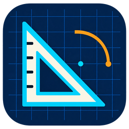

<div align="center">



# Lee's CAD

### 从几何线条，到自己的图纸。

本地优先的桌面二维 CAD。
在 Windows 与 Mac 上绘图、编辑、标注和出图，也可通过命令行处理文件。


[下载 Windows 版](https://github.com/lyq2010/lees-cad-releases/releases/latest) · [下载 Mac 版](https://github.com/lyq2010/lees-cad-releases/releases/latest) · [更新记录](https://github.com/lyq2010/lees-cad-releases/releases) · [反馈问题](https://github.com/lyq2010/lees-cad-releases/issues)

</div>

---

## 在本机完成二维绘图

- **绘制与编辑** — 直线、圆、圆弧、多段线等常用对象，配合移动、复制、旋转、缩放及撤销重做。
- **组织图纸** — 图层、颜色、线型、静态块、文字与标注，支持模型和布局工作区。
- **打开与输出** — DXF/DWG 读取与写出基础，以及 PDF、SVG、PNG 输出；复杂外部图纸的完整保真仍在完善。
- **按自己的方式操作** — 菜单、工具栏、命令行与 CLI；界面支持简体中文和英文。

0.1.3 修复 macOS DMG 安装后的严格签名检查；同时修复部分 DWG 删除或编辑后的保存失败，以及 macOS 从 Finder 双击打开图纸的问题；增加原生 SHX/BigFont 单线字形和复杂线型符号，改善中文字体选择，并限制过密填充的显示生成以降低卡死风险。字体从用户本机读取，发行包不附带第三方字库；缺失字体保留替代。保存继续执行原生数据回读校验，格式兼容须按具体图纸验证。

Windows 仅提供 MSI，CLI 随安装版提供；macOS 安装、更新及 CLI 包保留。原生多重引线、动态块、完整外参管理、自动保存与崩溃恢复仍有缺口，重要图纸请保留原件。

## 常用能力

| 功能 | 体验 |
| --- | --- |
| 二维绘图与编辑 | 常用几何对象、移动/复制/旋转/缩放与撤销重做 |
| 组织和标注 | 图层、线型、颜色、文字、标注与静态块 |
| 布局与出图 | 模型/布局工作区，输出 PDF、SVG、PNG |
| DWG 保存 | 合并实际编辑，保留未修改源数据，回读不一致时拒绝保存 |
| 中文交互 | 中英界面切换，中文命令提示、错误和设置窗口 |
| 命令行 | CLI 随 Windows MSI 提供，Mac 提供独立 CLI ZIP |

## 选择你的版本

| 平台 | 适用设备 | 安装或使用文件 | 更新记录 |
| --- | --- | --- | --- |
| Windows | x64，建议 Windows 11 | `lees-cad-0.1.3-windows-x64.msi` | [发行版](https://github.com/lyq2010/lees-cad-releases/releases) |
| Mac | Apple Silicon，包声明 macOS 11.0+ | `lees-cad-0.1.3-macos-aarch64.dmg` | [发行版](https://github.com/lyq2010/lees-cad-releases/releases) |
| Mac 命令行 | Apple Silicon | `lees-cad-cli-0.1.3-macos-aarch64.zip` | [发行版](https://github.com/lyq2010/lees-cad-releases/releases) |

本次发行只提供 Windows x64 与 Mac Apple Silicon。包声明的最低系统版本尚未完成逐版本实机验收；Intel Mac、Windows ARM64 等架构不在本次发行范围。

### Windows

1. 下载并运行 `.msi`，按安装器提示确认权限，将应用安装到本机。
2. 从开始菜单打开 **Lee's CAD**；桌面快捷方式可在安装时选择。
3. 安装目录中同时提供命令行工具 `lees-cad-cli.exe`。

Windows 包使用维护者自签证书；系统可能显示未知发布者或信任提示，安装器不会自动导入证书。下载来自本仓库的文件，并用发行版 `SHA256SUMS` 校验。

### Mac

1. 下载并打开 `.dmg`，将 **Lee's CAD** 拖入「应用程序」。
2. 首次打开若被系统阻止，可在「系统设置 → 隐私与安全性」确认允许。
3. 打开应用，新建图纸或先使用已有图纸的副本。

Mac 版采用 ad-hoc 签名，不使用 Developer ID 或 Apple 公证。`.app.tar.gz` 是应用内更新包，首次安装请选择 DMG。

## 命令行也能处理图纸

Windows CLI 随 MSI 安装版提供；Mac CLI 使用独立 ZIP。

```text
lees-cad-cli --version
lees-cad-cli commands
lees-cad-cli info example.dxf
lees-cad-cli convert example.dxf output.pdf
```

格式转换与保存遵循相同的保真保护，不能转换的输入会明确报错。

## 图纸与更新，由你掌握

图纸在本机处理，应用不自动上传工程图，不要求厂商账户。帮助菜单「检查更新」由你主动触发；离线设置可阻止更新联网。更新优先使用维护者 COS 主源，并检查 R2 备源，只接受通过发行清单签名、包签名、大小与 SHA-256 校验的资产。

公开发行版提供安装包、应用更新包、CLI、独立签名、平台信息、签名发行清单及 `SHA256SUMS`。原始源码在私有仓库维护，公开仓不提供源码或构建日志。

## 反馈与许可

通过 [Issues](https://github.com/lyq2010/lees-cad-releases/issues) 提交应用版本、系统版本、文件格式和复现步骤。优先使用合成图或脱敏副本，请勿上传私人图纸、账号凭据或包含隐私的原始日志。

随包提供 MIT / Apache-2.0 许可证、原作者版权和第三方归属声明。具体许可见安装目录中的 `LICENSE-MIT`、`LICENSE-APACHE`、`NOTICE` 与 `ATTRIBUTION.md`。

Lee's CAD 独立维护，与 Autodesk, Inc. 无关联；AutoCAD 和 DWG 是 Autodesk, Inc. 的商标。
